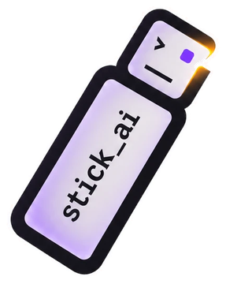
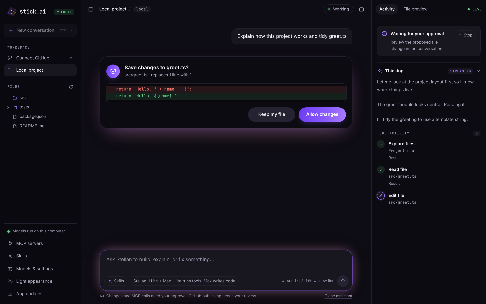
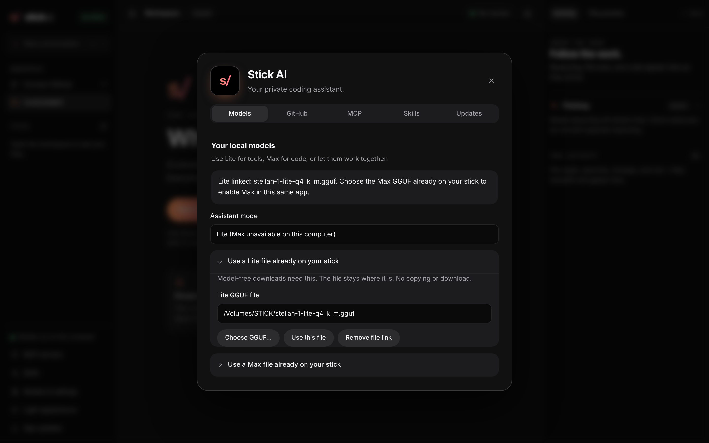
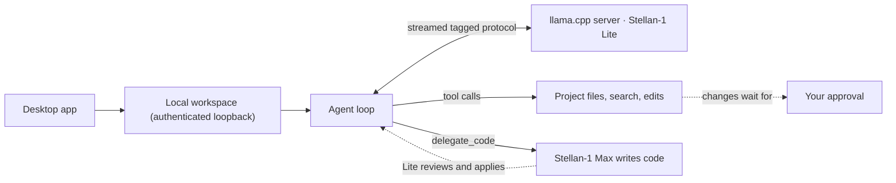

<div align="center">

<picture>
  <source media="(prefers-color-scheme: dark)" srcset="docs/brand/logo-dark.png">
  
</picture>


# Stick AI

**A private coding assistant that runs entirely on your computer.**

Ask Stellan to explore, explain, fix or build code. It reads your files, plans the work, asks before it changes anything, and never sends your code or prompts anywhere. Everything runs from a USB stick or a folder on your computer.

[](#install)
[](#install)
[](#install)
[](#privacy)
[](#benchmarks)
[](https://github.com/alfredmurray-goat/stick_ai/actions/workflows/desktop.yml)
[](LICENSE)

</div>

## Features

- **Fully local.** Stellan runs on your own computer through a bundled llama.cpp server. No account, no cloud, no telemetry.
- **Two models, one flow.** Stellan-1 **Lite** explores your project and runs tools; Stellan-1 **Max** writes larger pieces of code. Lite + Max work together automatically with 24 GB of memory or more; on 16 GB you can still choose Max, with a warning that it may be very slow. Use them together, Lite on its own, or Max directly.
- **You stay in control.** Every file change waits for your approval, shown as a red and green before-and-after diff. GitHub publishing waits for your review.
- **Watch it think.** Stellan's thinking, file reads, searches and Lite → Max handoffs stream live in the conversation, then fold into a short "Thought for 12 s · 2 steps" line you can open again. The Activity panel shows the same in more detail.
- **Readable answers.** Replies render with headings, lists, tables and code blocks with syntax colours (JavaScript/TypeScript and other C-style languages, Python, shell, JSON, CSS, HTML, YAML/TOML and SQL) and a Copy button.
- **Fast follow-ups.** Stellan remembers the conversation between steps instead of re-reading it, so a follow-up step on a 4-core computer took about 5 seconds instead of about 95 in testing.
- **Apple Silicon GPU.** On M-series Macs, Lite runs on the GPU through Metal, and falls back to the CPU automatically if the GPU can't load it.
- **Bring your own models.** The model-free download is the same app with no model files inside. Point it at your own Lite and Max GGUFs and nothing is copied.
- **GitHub workspaces.** Connect a repository, ask for changes, review the diff and open a draft pull request, without touching your default branch. Sign in with GitHub with a short code (no tokens to create), and choose exactly which repositories Stick AI may use.
- **Web search, built in.** Lite can look things up on the live web with [Actuent](https://actuent.ai): docs, versions, error messages, prices, events and news. It's free, needs no account, and every search shows you the exact words before anything goes online. Turn it off in Settings → MCP.
- **MCP servers and skills.** Connect local or remote MCP tool servers and reusable SKILL.md workflows. Every MCP call asks first.
- **Hooks.** Like Claude Code's hooks: run your own command, or notify another app on your computer, when you send a message, before or after Stellan uses a tool, when it needs your approval, or when it finishes. A hook can stop a message or tool call, or add notes for Stellan, but it can never approve anything for you. See [HOOKS.md](docs/HOOKS.md).
- **Signed app updates.** The app checks for signed updates and installs them without re-downloading your models.

<table>
  <tr>
    <td width="50%"></td>
    <td width="50%"></td>
  </tr>
  <tr>
    <td align="center"><b>Every change is yours to approve</b></td>
    <td align="center"><b>Light and dark, following your system</b></td>
  </tr>
</table>

## Benchmarks

Measured with the release Lite GGUF and the app's own llama.cpp server settings, CPU only, on a 4-core cloud machine.

| Benchmark | What it measures | Stellan-1 Lite |
| --- | --- | --- |
| **HumanEval, all 164 problems** | Writing a Python function that passes hidden unit tests | **120 / 164 (73.2%)**, pass@1 |

- **How it was run.** One greedy attempt per problem (temperature 0), with every answer executed against HumanEval's official tests. The 95% confidence interval is about **66% to 79%**.
- **Against the 2023 flagships.** OpenAI reported [67.0% for GPT-4](https://arxiv.org/abs/2303.08774) and Anthropic [71.2% for Claude 2](https://www.anthropic.com/news/claude-2), each with its own prompts and settings. Newer cloud models score over 90% (Anthropic reported [92.0% for Claude 3.5 Sonnet](https://www.anthropic.com/news/claude-3-5-sonnet) in 2024), and most of the newest ones no longer publish HumanEval at all.
- **For context.** On the full set, Mistral's Codestral Mamba 7B reports [75.0%](https://huggingface.co/mistralai/Mamba-Codestral-7B-v0.1) and Qwen2.5-Coder-7B-Instruct reports [88.4%](https://arxiv.org/pdf/2409.12186). Those runs used different prompts and settings, so this isn't a strict head-to-head.
- **Max.** On the 16 GB benchmark machine, Max loaded and read prompts at about 6 tokens a second, but then kept re-reading its 14.3 GB file from disk (about 210 MB/s) and gave no answer within 20 minutes. Its score will be measured on a machine with 32 GB.

**Speed in the real app.** The same two-message task (read two files, explain them, then read a third) took **850 s before** the prompt-cache change and **421 s after**, on the same machine. Writing an answer after a file read went from 172 s to 36 s.

## Download

Stick AI ships preinstalled on a USB stick (launching February 2027 in the EU and May 2027 worldwide). Builds aren't public downloads: each release is kept as a **private draft** on [GitHub Releases](https://github.com/alfredmurray-goat/stick_ai/releases) that only people with write access to this repository can see, and is used to prepare the sticks. Sold sticks get app updates from a private, signed update host instead (see [docs/UPDATES.md](docs/UPDATES.md)). Each build produces **one** release, `Stick AI — all devices — build N`: a small `stick_ai-all-devices.zip` with the apps and the `stellan` folder (no models; the stick's own `stellan/models` are used), install helpers, checksums and the signed app updates. See **[docs/STICKS.md](docs/STICKS.md)** for how to make a stick.

One stick works on every supported computer: the three apps sit at the top of the stick and share one `stellan` folder with a single copy of Lite and Max (about 19 GB, so use a 32 GB stick formatted as exFAT).

| Computer | Open on the stick | You need |
| --- | --- | --- |
| Mac (Apple Silicon or Intel) | `Stick AI.app` (one universal app) | macOS 13.5+, 8 GB RAM |
| Windows x64 | `Stick AI.exe` | Windows 10+, 8 GB RAM, Edge WebView2 |
| Linux x64 | `stick-ai` | glibc 2.35+, GTK 3, WebKitGTK 4.1, 8 GB RAM |

Max works best with 24 GB of memory or more. On 16 GB you can still choose it (Settings → Models → Max directly), but the app warns first: there it keeps re-reading its 14.3 GB file from disk and a reply can take many minutes or seem stuck. On 16 GB the app uses Lite by default and never switches Max on by itself.

> [!TIP]
> Use the **Install on stick** helper from the zip rather than dragging folders: it merges onto the stick and never deletes `stellan/models`.

> [!NOTE]
> These are unsigned test builds. The first time you open one, macOS Gatekeeper or Windows SmartScreen may ask you to confirm. On a Mac, if it says the app can't be opened, go to **System Settings → Privacy & Security** and click **Open Anyway** (macOS 15 and later removed the old right-click → Open shortcut). On Windows, click **More info → Run anyway**. Apps run from an exFAT stick usually aren't flagged at all, because exFAT can't store the "downloaded from the internet" mark. [docs/FIRST_OPEN.md](docs/FIRST_OPEN.md) has the full steps and the printable card for the box.

## Install

1. Plug in the stick (or [make one](docs/STICKS.md)).
2. Open **Stick AI** (`Stick AI.app`, `Stick AI.exe` or `stick-ai`).
3. Click **Open workspace**. Stellan loads on your computer and the workspace opens.

No terminal, Node.js or Ollama is needed. `Start.command`, `Start.bat` and `start.sh` are technical fallbacks that open the same workspace in your browser.

### Model-free download

<p align="center">
  
</p>

1. Open the app. The welcome screen shows **Choose your Lite GGUF**.
2. Pick your `stellan-1-lite` `.gguf` file. **Open workspace** unlocks.
3. Optionally, link Max under **Models & settings → Use a Max file already on your stick**.

Files are linked by path, never copied. Keep them outside the app folder, for example beside it on the same stick, and they keep working if you move the whole stick. If a linked file changes, the app asks you to choose it again.

## Using the workspace

- **Welcome tour.** The first time the workspace opens, a four-step tour explains the models, approvals and where your project lives. Reopen it from Settings → Models. A printable quick-start leaflet for the box is in [`docs/packaging`](docs/packaging/quick-start-guide.pdf).
- **Ask anything.** Type in the box at the bottom, or start from a suggestion such as *Explore this project* or *Find a bug*. Press ↵ to send and Shift ↵ for a new line.
- **Approve changes.** When Stellan wants to edit a file, an approval card shows the exact before-and-after lines. Click **Allow changes** or **Keep my file**.
- **Follow along.** Under each message, a live line shows what Stellan is doing; click it to read its thinking and each step. The **Activity** panel has the full detail. **Stop** or Esc cancels at any time.
- **Resting.** After 10 quiet minutes the model is paused so it stops holding memory (about 4.5 GB for Lite), and the status says **Resting**. Your next message wakes it in a few seconds with the conversation intact.
- **Run tests.** Stellan can run a command such as your project's tests to check its own fixes. Each command shows an approval card first. On Mac and Linux it runs in the computer's sandbox (only the project folder can change, no internet); on Windows there is no sandbox, so the card warns that it runs with your permissions.
- **Edit files yourself.** Click a file in the sidebar to open it in **File preview**, edit it and save.
- **Use skills.** Type `/` to pick a skill, or manage them under **Skills**.
- **Switch appearance.** It follows your system's light or dark mode until you choose one.

<p align="center">
  
</p>

## Privacy

- **Inference is offline.** Prompts, code and answers stay on your computer. The model server listens only on an authenticated local connection.
- **No telemetry.** There are no analytics or cloud fallbacks.
- **What does use the network.** The app checks GitHub for signed app updates (you can turn this off), GitHub workspaces talk to GitHub when you connect them, web search sends only the search words or page address you approve to Actuent (never your code or files), and remote MCP servers receive only the calls you approve.
- **One switch for all of it.** **Settings → Models → Allow internet** is on by default. Turn it off and nothing leaves the computer: no web search, GitHub, remote MCP servers, hooks that notify other computers or automatic update checks. Stellan works exactly the same, because it never needed the internet. (Activating a new stick with its printed code goes online once either way.)
- **Integrity checks.** Every app file is checked against a recorded SHA-256 before starting. A changed file is reported, not run.

## How it works



- **Tagged protocol.** Lite replies in plain text with `<tool_call>{...}</tool_call>`, `<think>…</think>` and `<done>…</done>` tags, constrained by a grammar. The app runs one validated tool call per step and replies with `<tool_result>…</tool_result>`. Allowed tools: `list_dir`, `read_file`, `write_file`, `edit_file`, `search_files`, `run_shell`, `delegate_code`.
- **Lite and Max take turns.** In paired mode, only one model is loaded at a time. When Lite delegates, Max is started, writes the code, and Lite is restarted to review and apply it.
- **Prompt cache.** Lite keeps its conversation cache with one context checkpoint (about 0.3 GB), and old tool output is trimmed in large steps so the start of the conversation stays identical. Each step processes only new text.
- **Instructions read once.** The system message is the same for the whole session; the project file list, named files and skill guidance travel with each task instead. Right after Lite starts, it reads that system message in the background while you type, and saves the result so **New conversation** reloads it in a fraction of a second. On 4 CPU cores the first reply read 75 new tokens instead of 1,721, and took 60 s instead of 116 s.
- **Nothing runs when idle.** The window waits for the app to report a change instead of asking twice a second, and the model rests after 10 quiet minutes (`STICK_REST_MINUTES` changes this; `0` turns it off).
- **Big context windows.** Lite is a pure Mamba2 model: it keeps a fixed-size memory of the conversation, so its window costs no extra RAM (measured 8.0 GB at both 8,192 and 131,072 tokens). The app gives Lite 65,536 tokens and Max 8,192 (16 GB), 16,384 (24 GB) or 32,768 (32 GB+) tokens, with an 8-bit attention cache that halves Max's memory per token.
- **Long context mode.** Settings → Models → Memory: Lite 262,144 tokens, Max up to 65,536, and about 100k tokens of conversation kept word for word. A clear warning says it can be much slower on an ordinary laptop when a long conversation has to be read again; switching restarts the model.
- **Smart compaction.** When a new task starts and the conversation is over its budget, older tasks become a short summary (what you asked, which files and tools were used, what Stellan answered) and the newest stay word for word. It is built from the conversation itself, so it takes no time and invents nothing.
- **Faster code from Max.** Max uses n-gram speculative decoding: when it rewrites code it has already seen, it drafts the copied text in chunks. A 25-function rewrite on 4 CPU cores went from 4.3 to 12.4 tokens/s with identical output; normal answers are unaffected. If a computer's llama.cpp refuses these settings, Max starts once more without them.
- **GPU.** Apple Silicon builds include llama.cpp's Metal backend. Lite uses the GPU there; Max uses it only with 24 GB or more, because macOS limits GPU memory to about two thirds of RAM. Macs running as virtual machines stay on the CPU, because their virtual GPU is far slower. Set `STICK_GPU=0` to force the CPU.

## Configuration

| Variable | Default | What it does |
| --- | --- | --- |
| `STICK_GPU` | on (Apple Silicon) | `0` keeps every model on the CPU. |
| `STICK_CONTEXT_MAX_BYTES` | `16384` | How much tool output and named-file context is sent per request (256 to 1048576). |
| `STICK_MODEL` | `stellan-1-lite` | Terminal model: `stellan-1-lite` or `stellan-1-max`. |
| `STICK_BASE_URL` | `http://localhost:11434` | Terminal model endpoint (`/v1/chat/completions`). Local addresses only unless `--allow-remote`. |
| `STICK_SHELL` | your shell | Shell for `run_shell`, for example `pwsh.exe` on Windows. |

## Terminal use

Stick AI also runs as a terminal assistant with your own Ollama models. Use Node.js 24.22.1 and npm.

```sh
npm install
npm run build
npm test
npm link
```

Prepare Stellan in Ollama by placing your verified `stellan-1-lite.gguf` and `stellan-1-max.gguf` in the `ollama/` folder, beside the Modelfiles:

```sh
ollama create stellan-1-lite -f ollama/Modelfile
ollama create stellan-1-max -f ollama/Modelfile.max
ollama serve
```

Then run from the project you want to edit:

```sh
stick doctor
stick chat
stick run "Inspect this repository and fix its failing tests"
```

<details>
<summary><b>More about terminal use</b></summary>

- Writes, edits and every shell command need your approval. `--yes` skips approval for that one run. Non-interactive runs deny changes unless `--yes` is given.
- `/exit` exits, `/clear` deletes the current history and `/history` shows it. Ctrl+C cancels the active request, approval or command and keeps the chat open. A cancelled one-shot run exits with status 1, and reaching the step limit exits with status 2.
- `.stick/config.json` holds `model`, `baseUrl` and `maxSteps` (1 to 1000). `STICK_MODEL` and `STICK_BASE_URL` override them. Only `localhost`, `127.0.0.1` and `::1` are accepted unless you pass `--allow-remote`, which sends prompts and tool results to that endpoint.
- Max is locked on computers with less than 16 GB (below 15 GiB of total RAM reported, to allow for memory the firmware and graphics keep). From 16 GB it can be chosen, with a warning below 24 GB (22 GiB reported) that it may be very slow. `--force-max` overrides the lock for one run, with a warning that Max may be very slow or crash. `stick doctor` shows total memory and the lock status without loading a model.
- Files must be UTF-8 and at most 1 MiB. Search returns up to 200 matching lines and skips `.git`, `.stick` and `node_modules`. There is no execution or inactivity deadline; use Cancel or Ctrl+C.
- History is appended to `.stick/history.jsonl`, and one session per project is enforced with `.stick/session.lock`. History stores source contents in plain text, so keep `.stick` out of version control.

</details>

## Shell sandboxing

| Platform | Backend | Limits | Fallback |
| --- | --- | --- | --- |
| macOS | Apple `sandbox-exec` with a deny-by-default profile | Project read/write; system and developer tools read-only; no network | Restricted mode with a warning |
| Linux | bubblewrap with user, mount, PID and network namespaces | Project writable; toolchains read-only; no host network | Restricted mode with a warning |
| Windows | Restricted child process | Working-directory check and cleaned environment only. **No filesystem or network isolation.** | Always shows its warning |

Restricted mode does not confine arbitrary shell syntax: a command can use absolute paths, reach the network or change files outside the project. File tools still enforce their own path rules. Commands that a sandbox denies are never retried unsandboxed. Review every command you approve.

<details>
<summary><b>Sandbox details</b></summary>

- At startup the app probes the native sandbox with a fixed `exit 0` command and a three-second deadline. `stick doctor` prints the platform, backend, shell, working directory and any fallback warning. A successful probe is not a full confinement audit.
- POSIX commands use your `SHELL`. Windows uses `cmd` by default; choose PowerShell with `STICK_SHELL`. PowerShell receives the command as UTF-16LE encoded text, and cmd receives it with `/d /s /c`. Approval shows the JSON-encoded command, working directory and backend.
- The environment keeps `PATH` and essential Windows loader variables, removes inherited credentials and injection variables, and points home and temporary directories inside the project. Cancellation kills the process group (POSIX) or the process tree with `taskkill /T /F` (Windows). Reparented processes are outside that guarantee.
- File tools resolve real paths and reject traversal, absolute and drive-prefixed paths, escaping or dangling symlinks, special files and hard links. Windows drive and UNC boundaries, device names and alternate streams are checked.
- Do not run untrusted processes that rename directories or change mounts while file tools are working. Node.js path APIs can't give a race-free sandbox against a hostile local process.

</details>

## Troubleshooting

<details>
<summary><b>The app says the stick may be damaged</b></summary>

A file doesn't match its recorded checksum. Download a fresh copy and extract it again, keeping the whole folder together. In model-free copies, missing model files are expected and aren't reported as damage.

</details>

<details>
<summary><b>Open workspace does nothing, or asks for a Lite file</b></summary>

This is a model-free download with no Lite linked yet. Click **Open workspace** or **Choose your Lite GGUF** and pick your Stellan-1 Lite `.gguf`. If the file moved or changed, choose it again. The `.gguf` needs about 4.1 GB of free space wherever you keep it.

</details>

<details>
<summary><b>On a Mac, the assistant won't start</b></summary>

The first time, if macOS refuses, open **System Settings → Privacy & Security** and click **Open Anyway**. A zip downloaded in a browser marks every file inside as "from the internet", and macOS refuses to run the bundled model server until that mark is cleared. From this version the app clears it itself, but only for its own runtimes after checking their checksums. With an older copy, run this once in Terminal, dragging the **Stick AI** folder in for the path:

```bash
xattr -dr com.apple.quarantine "/path/to/Stick AI"
```

The app's logs are in `~/Library/Logs/build.localilabs.stickai/`.

</details>

<details>
<summary><b>The first answer takes a long time</b></summary>

The first message in a conversation has to be read in full, which can take a minute or more on a laptop CPU. Follow-up steps reuse that work and are much faster. Apple Silicon Macs use the GPU and are faster still. The activity panel shows live progress, and Stop cancels.

</details>

<details>
<summary><b>Max is unavailable</b></summary>

Max needs at least 16 GB of memory (24 GB recommended) and a Max GGUF that is bundled or linked. On 16 GB it can be very slow, so the app warns first; on less, use Lite.

</details>

<details>
<summary><b>macOS sandbox-exec warnings</b></summary>

Apple marks `sandbox-exec` deprecated. Run `stick doctor` after macOS upgrades. If it's missing or unusable, the app uses restricted mode and warns before every command. Use a VM or container when you need enforced isolation.

</details>

<details>
<summary><b>Linux: bubblewrap missing or blocked</b></summary>

Install your distribution's `bubblewrap` package and run `stick doctor`. Containers, AppArmor or disabled user namespaces can stop it from starting; the probe reports why and falls back to restricted mode with a warning.

</details>

<details>
<summary><b>Windows: command warnings</b></summary>

The warning is expected. Windows commands run with your account's permissions because the app can't create a restricted token or Job Object. Only approve commands you trust, and prefer a VM for untrusted projects.

</details>

## Development

```sh
npm run check
npm test
npm run build
node dist/cli/index.js doctor
STICK_INTEGRATION=1 npm test -- tests/integration.test.ts
npm run licenses
```

CI runs type checks and the test suite on Ubuntu, macOS and Windows. The [Desktop builds](https://github.com/alfredmurray-goat/stick_ai/actions/workflows/desktop.yml) workflow builds all four platforms and runs a real Lite tool exchange on each before anything is published. Source lives in `src/cli`, `src/agent`, `src/tools`, `src/model`, `src/config`, `src/sandbox` and `src/portable`, with the desktop shell in `src-tauri` and the workspace UI in `portable/ui`.

More detail: [DESKTOP.md](docs/DESKTOP.md) (desktop app), [BUILDS.md](docs/BUILDS.md) (packages and releases), [PORTABLE.md](docs/PORTABLE.md) (USB browser launcher), [UPDATES.md](docs/UPDATES.md) (signed updates), [GITHUB_WORKSPACES.md](docs/GITHUB_WORKSPACES.md), [MCP_SKILLS.md](docs/MCP_SKILLS.md), [HOOKS.md](docs/HOOKS.md), [ACTIVATION.md](docs/ACTIVATION.md) and [VERIFICATION.md](docs/VERIFICATION.md) (what has and hasn't been verified).

## Contributing

Contributions are welcome. [CONTRIBUTING.md](CONTRIBUTING.md) explains how the pieces fit together, how to build and test, and how to open a pull request. AI coding agents should read [AGENTS.md](AGENTS.md), and [HANDOVER.md](HANDOVER.md) covers the current state of the project and what's next.

## Limits

- **Review what it writes.** Stellan can make mistakes. In stricter tests it mis-copied long random identifiers.
- **Lite's chat template.** The supplied Lite GGUF has no embedded template, so the app uses a tested Mistral-v1 formatter. The original training template is unverified.
- **Unsigned builds.** Gatekeeper, SmartScreen, clean-machine launch and physical USB performance still need manual checks.
- **Memory is total, not free.** The 8 GB, 16 GB and 24 GB thresholds use total RAM (checked as 7, 15 and 22 GiB, because computers report a little less than they're sold with), which doesn't guarantee enough free memory for every task.

## Licences

- [LICENSE](LICENSE): MIT, copyright localilabs, for the Stick AI source.
- [NOTICE](NOTICE): the retained gpt-engineer MIT notice and Mistral AI base-model attribution. Stick AI is a TypeScript rewrite inspired by [gpt-engineer](https://github.com/gpt-engineer-org/gpt-engineer), with no reused Python code.
- [MODEL_LICENSE.md](MODEL_LICENSE.md): Stellan base model, LoRA provenance, dataset licences and outstanding provider-terms review.
- [THIRD_PARTY_LICENSES.md](THIRD_PARTY_LICENSES.md): generated runtime dependency notices. Each package also includes llama.cpp, Node.js and desktop runtime notices.
